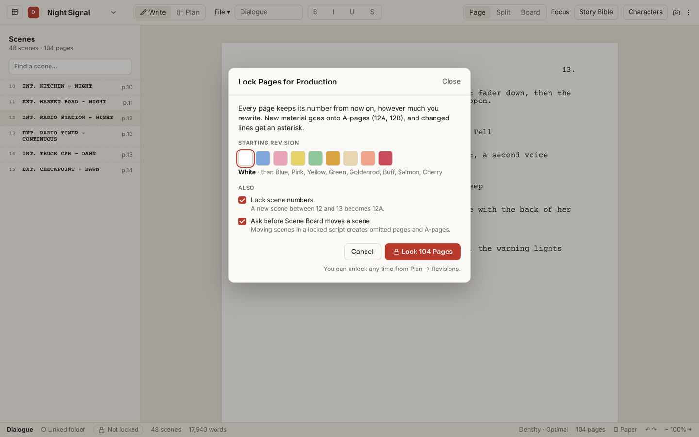
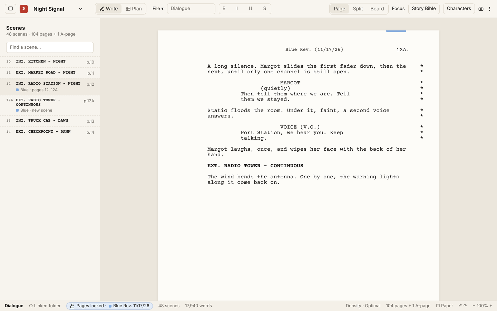
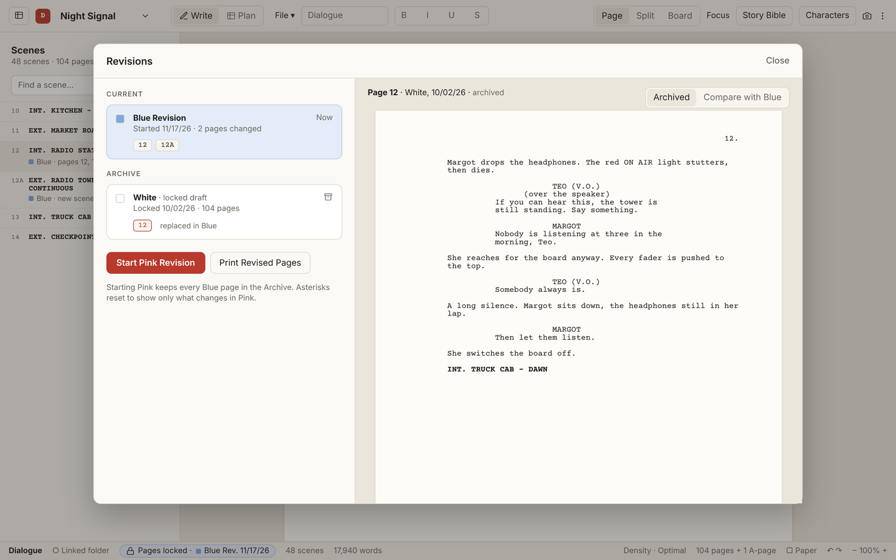

# DraftLine Pro: Production, Page to Production

> **Status: Indefinitely deferred — revisit only after demonstrated product traction and community support.**
> Not approved for implementation. No timeline.
>
> **No existing DraftLine functionality may be removed, restricted, or transferred from the free browser application
> to a paid product.** Everything here would be *added* beside the free Plan workspace, which keeps all of its
> current production tools (Breakdowns, Stripboard, Reports, and the coming Schedule and Budget).
>
> **Pricing direction (not final):** about **$9.99/month**, **including everything in Pro: Co-Write**. The licence is
> tied to the writer, not the platform: a token entered in Settings → Pro License unlocks Production in the browser,
> the installed app and the planned desktop and Android apps. No accounts. Patreon's Writers' Room and Executive Producer
> tiers are planned to include a Production licence. See [`co-write.md`](co-write.md) §6.

Feasibility assessment written November 2026 against DraftLine 0.11.0 (commit `4a72ac6`; references re-checked at
`343c49a`). Line numbers drift, so use function names as the stable reference.

- **[Confirmed]** means verified in the code.
- **[Hypothesis]** means reasoning or third-party information not yet tested.

Related:
- [`revision-mode.md`](revision-mode.md): the October 2026 design, kept for its UX sketch and the "computed marks"
  idea. Where the two disagree, this document wins.
- [`../../ROADMAP.md`](../../ROADMAP.md) (Phase 3).
- Mockups: [Appendix](#appendix-mockups).

---

## 1. Concept

Advanced shooting-script workflows for scripts in production:
- **Locked pages**: fixed page identities, with A-pages (12A, 12B) for overflow and OMITTED or combined pages.
- **Locked scene numbers**: suffixed insertions and OMITTED scenes.
- **Coloured revision rounds**: White → Blue → Pink…, with dates, header slugs and asterisks on changed lines.
- **A revision archive** of replaced pages.
- **Production PDFs**, including revised pages only.

**Future navigation (decided November 2026, not to be built now):**
- A new **Shoot** button, Lucide `clapperboard`, goes **to the right of Board** in Write's view switch, which then has
  four buttons: **Page | Split | Board | Shoot**.
- **Plan** (beside Write in the workspace switch) changes from `Clapperboard` to Lucide `clipboard-check`
  (`ClipboardCheck`).
- **Page, Split and Board** keep their icons. Both icons are confirmed present in the pinned `lucide-react` 1.49.0.

Today `App.jsx` has `WORKSPACES` Write (`PenLine`) | Plan (`Clapperboard`) and `VIEWS` Page (`FileText`) | Split
(`Columns2`) | Board (`SquareKanban`). Points to settle at implementation:
- the four-button view switch must still fit, or collapse into ⋮ the way the views already do on narrow windows
  (`toolbar.js` `writeViews`);
- what the Shoot view shows for a script that isn't locked (likely an explanation and the lock action);
- the Shoot button is visible only to Production subscribers, or visible to everyone as an introduction. This needs
  care not to clutter Core (P11).

## 2. Q1: Can production page locking coexist safely with normal pagination?

**Answer: yes, if locked pagination is a separate layer that runs only for locked scripts and reuses today's
`paginate()` unchanged.** Locking adds constraints. It does not remove pagination complexity.

**[Confirmed] How pagination works today** (`src/lib/screenplay.js` `paginate`):
- One pass over the whole script onto 54-line pages (`PAGE_LINES`).
- Speeches split with (MORE)/(CONT'D) only when `SPLIT_MIN_LINES` (2) dialogue lines land on each side.
- Headings stay with what follows them, and transitions with what precedes them.
- Dual dialogue never splits.

Pages are **integers** everywhere:
- `pageLabel(p)` = `p + 1`.
- `place[k].pos = page × 54 + line`, which scene lengths and eighths are computed from (`App.jsx` scenes memo).
- `pageOfBlock`, used by Find, Format Doctor, Dialogue Tuner, the status bar and Plan.
- Page cards in `Editor.jsx`, `PrintView.jsx`, and the PDF (`pdf/scriptPdf.js` `layoutScriptPdf`).

**[Hypothesis] Proposed approach**
- `paginateLocked()` splits the script at stored page anchors and runs the existing `paginate()` per segment.
- Overflow is labelled 12A, 12B. An empty segment becomes an OMITTED or combined page.
- Consumers move from integers to page *labels*.
- Ordinary mode never calls the new code.

**Risks**
- **[Confirmed] The editor and the PDF count lines differently.** The editor paginates from browser-measured line
  counts (`App.jsx`: `paginate(items, lineMap)`). The PDF uses the wrap model (`scriptPdf.js`: `paginate(items)`).
  The library page count also uses the wrap model (`projectStorage.js` `projectStats`). **No test asserts that they
  agree.** With locked pages, a one-line difference could create 12A in the PDF but not on screen. Locked mode needs
  one authoritative line count, likely the deterministic wrap model.
- **[Confirmed] Element ids change on some edits, so anchors can drift.** Ids are stable through typing, Dialogue
  Tuner, rename and Scene Board moves (`sceneSync.js` moves whole chunks). They are *not* stable through:
  - Enter mid-element (`Editor.jsx` `tailBlock` → `makeBlock`);
  - Format Doctor splits (`formatDoctor.js` `applyFixes` → `newId()`);
  - import and paste (`App.jsx` → `makeBlock`);
  - deletion.

  **[Hypothesis]** Anchors need a fallback chain (anchor id → offset remapped through `diffWords` → recorded
  neighbours → omitted), and must **warn visibly rather than silently re-attach**.
- **[Hypothesis] Dialogue across a locked boundary.**
  - A locked page that starts mid-speech must always open with `NAME (CONT'D)`.
  - A forced boundary can break `SPLIT_MIN_LINES`, which needs a decision (P5).
  - An anchor inside dual dialogue must snap to the pair's start.
- **[Confirmed] Mobile and IME are a known hazard.** The phone view takes breaks from a hidden page-width copy
  (`Editor.jsx` `PageMeasure`), and `tests/browser/composition.browser.js` exists because composing across a seam
  once doubled words. **[Hypothesis]** Locked pages add more forced seams, so that protection and that test must
  cover locked boundaries.

**[Confirmed] Tests that protect ordinary writing today**
- `tests/pageSeams.test.js` (25 cases);
- `tests/scriptPdf.test.js` (45);
- `tests/phoneView.test.js` (12);
- `tests/fontRemeasure.test.js`;
- `tests/browser/composition.browser.js`.

## 3. Q2: Can revision data survive saving, exporting, importing and opening across versions?

**Answer: losslessly in DraftLine's own format, once one prerequisite is fixed. Only partially in other formats.**

**[Confirmed] Storage facts**
- One IndexedDB record per project (`projectStorage.js`, `DB_VERSION = 1`).
- `.draftline` backups wrap the record verbatim (`backup.js`, `BACKUP_VERSION = 1`, which refuses newer versions).
- Folder sync writes the same files plus `Snapshots/` files, newest `updatedAt` wins (`folderSync.js`).
- Snapshots are whole-project copies stored under the field name **`revisions`** (`revisions.js`). They are
  deletable (`removeRevision`).

**[Confirmed] Older versions drop data they don't recognise.**
- `toRecord()` builds the saved record from an explicit field list, so any new field is **dropped when an older
  DraftLine saves the project**.
- `normalizeProduction()` likewise keeps only `version` and `scenes`.

A project with revision data, opened by an older cached PWA, an older build on a second synced computer, or a
restored backup, would lose that data silently on the next auto-save. **Prerequisite:** the free app must keep
unknown fields on save, shipped well before any such data exists. The same fix protects Schedule and Budget.
`BACKUP_VERSION` should not be bumped for this, because that makes older apps refuse the file outright.

**Other formats**
- **PDF [Confirmed pipeline, Hypothesis output]**: the dependency-free writer (`pdf/`) can draw labels, slugs,
  asterisks, OMITTED and revised-pages-only. It is the realistic production deliverable.
- **FDX [Confirmed today]**: `toFDX` writes `Number="${++sceneNo}"`, so locked scene numbers are renumbered on export.
  Final Draft's revisions and page settings are not carried. The 12 fixtures are **constructed, not saved from Final
  Draft** (`tests/fixtures/fdx/README.md`, "Known gaps").
- **FDX [Hypothesis, third-party]**: revisions sit in `<Revisions>` with per-run `<Text RevisionID>`. Locked pages are
  `LockedPage` entries with `PageNumber` and a document-wide character `Position`. How A-page labels appear in real
  files is unknown. Even with perfect data, **Final Draft repaginates with its own engine**, so its breaks won't match
  DraftLine's. Scene-number export is feasible now (fixture `05-scene-numbers.fdx`). Do **not** promise round-trips
  of revisions or locked pages.
- **Fountain [Confirmed]**: `parseFountain` strips `#12A#` scene numbers and `toFountain` never writes them. Adding
  scene numbers both ways is feasible. Fountain has no concept of locked pages, colours or marks.

## 4. Q3: What is the likely engineering complexity?

| Component | Complexity |
|---|---|
| Revision sets, colours, dates, slug data | Low |
| Computed line marks (diff of a baseline snapshot vs current, mapped to wrapped lines; `scriptDiff.js` exists) | Medium. Moved scenes show as delete + add under `diffScripts`. |
| Locked scene numbers (`analyzeScript` numbers sequentially today; touches Navigator, Board, Plan, PDF, Print, FDX, Fountain) | Medium |
| **Locked pages** (anchors, A-pages, omitted, label-aware consumers, one line-count source) | **High** |
| Revised-pages-only PDF | Medium |
| Archive view (a baseline snapshot paginated under the same anchors) | Low–Medium |
| Unknown-field pass-through | Low effort, high importance, and first |
| FDX scene numbers / revisions / locked pages | Low–Medium / Medium–High / High and uncertain |

- **A prototype** is locked pagination as a pure function in a branch, measured on real scripts, with editor and PDF
  agreement proven. That is roughly one to three focused weeks.
- **Production-ready** means a script coordinator could run several colour rounds on a 120-page script and trust
  every number on every device. That is months, not weeks.

Confidence is low until the decisions in §7 are made and real Final Draft files exist.

**Dependencies:**
- the line-count decision;
- real Final Draft `.fdx` files with revisions and locked pages;
- a production user to validate conventions;
- the pass-through prerequisite.

**Regression risk areas:**
- shared renderers (page cards, Print, PDF);
- every `pageOfBlock` consumer;
- snapshot restore over a locked script (the Project Lock already blocks restore; see the `App.jsx` padlock message);
- bulk edits creating mass asterisks (Format Doctor, character rename, Replace All);
- Scene Board moves in a locked script.

## 5. Q4: Can it stay isolated from ordinary DraftLine Core behaviour?

**For behaviour, yes. For code location, no.**
- `paginate()` is not modified. Locked mode is per project, and absent data means exactly today's behaviour.
- One editor and one rendering path. The locked layer produces the same page model with labels added.

Trade-offs:
1. **Some shared code must change while keeping identical output** for unlocked scripts: page labels, renderers that
   can draw slugs and asterisks, and the save path's unknown-field pass-through. Golden tests (PDF output and labels
   for unlocked scripts) must be written *before* any of that changes.
2. **An MIT, public codebase can't technically reserve a feature.** Exclusivity is a licensing choice: open code with a
   paid hosted or bundled offering, a closed add-on module, or a licence switch on open code.
3. **The free app must preserve Production data, and should display it read-only**, so a collaborator on Core sees
   the same page numbers as the production.

**Browser-first.** Nothing here needs a native desktop app. Pure layout, IndexedDB, Web Workers and the existing PDF
writer all work in the browser. See [`desktop-app.md`](desktop-app.md), which is a separate, optional initiative.

## 6. Smallest safe proof of concept (when revisited)

1. **Protect the free app first.** This is worth doing regardless of Production:
   - unknown-field pass-through in `toRecord`/`saveActiveProject` and `normalizeProduction`;
   - an editor-vs-PDF pagination parity test on fixture scripts;
   - golden tests for unlocked PDF output and labels.
2. **`paginateLocked()` off to the side.** A pure function in a branch, with no UI and no stored data. Lock a real
   script, apply scripted rewrites (grow a scene, delete one, split a speech at a boundary, run Format Doctor fixes),
   then check labels, determinism (editor model = PDF model) and timing on a 120-page script.

Suggested build order after that: colours, marks and revised-pages PDF with ordinary numbers → locked scene numbers →
locked pages → FDX interoperability, the last only once real Final Draft files are in `tests/fixtures/fdx/`.

## 7. Open decisions

- **P1. Navigation: decided.** **Shoot** (`clapperboard`) goes to the right of Board (Page | Split | Board | Shoot),
  and Plan's icon becomes `clipboard-check` (§1).
- **P2. Scene suffixes.** US prefix (A12, AA12, B12) or suffix (12A, 12AA, 12B)? The mockups assume 12A.
- **P3. Colours after Cherry.** Sources differ: Tan, Ivory, then Double White, or straight to Double White. Fixed or
  editable?
- **P4. Emptied pages.** One "14–15 OMITTED" card, a combined "14–15" page, or blank space kept?
- **P5. Forced boundaries.** If one would break `SPLIT_MIN_LINES`, allow the short piece or move the anchor with a
  warning?
- **P6. Marks.** Per line or per element? Do old asterisks clear when a new colour starts? Moved scenes: fully
  marked, or shown as moved?
- **P7. Line counts.** Wrap model (deterministic) or browser measurement (matches today's screen) in locked mode?
- **P8. Naming.** "Lock" already means Viewing (`lib/lock.js`, Ctrl+Alt+L) and the Project Lock (padlock). A third
  lock needs distinct words and a distinct icon.
- **P9. Unknown data.** In apps that can't render Production data: preserve silently, or preserve and open
  read-only?
- **P10. Licensing.** It is paid (about $9.99/month, direction only). How does that square with MIT source (§5,
  trade-off 2)?
- **P11. Shoot for Core users.** Hidden, shown as an introduction, or shown only once a script is opened that was
  locked by a subscriber (read-only display, §5 trade-off 3)?

## 8. Deferred even when revisited

- FDX `LockedPage` import and export.
- Multi-user revision editing.
- Watermarked or per-recipient PDFs, sides and call sheets.
- Lined scripts and script supervision.
- On-screen coloured paper.
- Diff move detection.
- Per-act locks.
- Any change to ordinary pagination.

## 9. Conditions for revisiting

Reopen this only when several of these are true:
- DraftLine has meaningful traction.
- Writers or productions ask for it unprompted.
- The free-app protections in §6 step 1 have shipped.
- Real Final Draft files with revisions and locked pages are available.
- A production user agrees to test a prototype.
- Core (Schedule and Budget) and Co-Write work are in a stable place.

## Appendix: industry conventions

Secondary sources ([Wikipedia: Shooting script](https://en.wikipedia.org/wiki/Shooting_script);
[method-storyteller PR #42](https://github.com/method-production-suite/method-storyteller/pull/42) and
[#40](https://github.com/method-production-suite/method-storyteller/pull/40) for FDX). All of it is
**[Hypothesis]** until checked with a working production.
- **A-pages:** a lengthened page 10 becomes 10 and 10A. A shortened page is combined (15–16) or kept with blank
  space. A page whose scenes are all removed is issued as OMITTED.
- **Scene insertion:** in the US, A11 between 10 and 11 (10A is avoided because it suggests a camera setup). In the
  UK, 10A, then 10AA, 10B. Omitted scene numbers are retired, not reused.
- **Asterisks:** right margin, one per changed line. Some productions consolidate them per speech, scene or page.
- **Slugs:** aligned with the page number, giving the date and colour. The title page lists every revision issued.
- **Reset:** productions often reissue a renumbered White draft before principal photography.

## Appendix: mockups

Conceptual images (November 2026, Editorial Light, an original sample script). **They show an earlier navigation
idea: locking opens from "Plan → Revisions", with no Shoot button.** The decided direction is a **Shoot** view to the
right of Board (§1), and the final interface may differ.

| | |
|---|---|
|  | **Locking.** A deliberate dialog with an explanation, the starting colour (White, with the sequence shown), "Lock scene numbers" and "Ask before Scene Board moves a scene". |
|  | **Writing in a revision.** Page 12A with "Blue Rev. (11/17/26)", a thin blue tab on the page, asterisks on changed lines, 12A scene tags, and one status chip. Its padlock icon clashes with the Editing/Viewing badge (P8). |
|  | **Revisions and Archive.** The current Blue set, the White archive with page 12 as it was, Compare, Start Pink Revision, and Print Revised Pages. |

Principles they follow: nothing appears until a script is locked, a single status chip, marks in the margins only,
and colour as a small tab rather than tinted paper.
